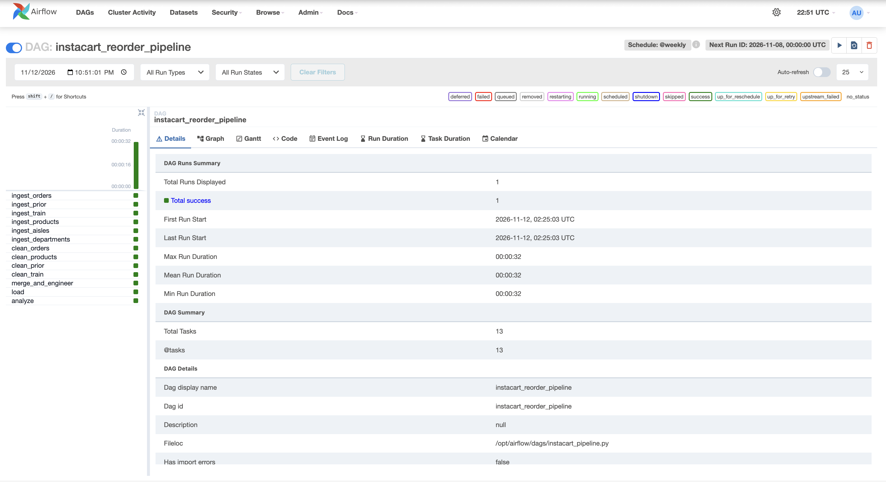
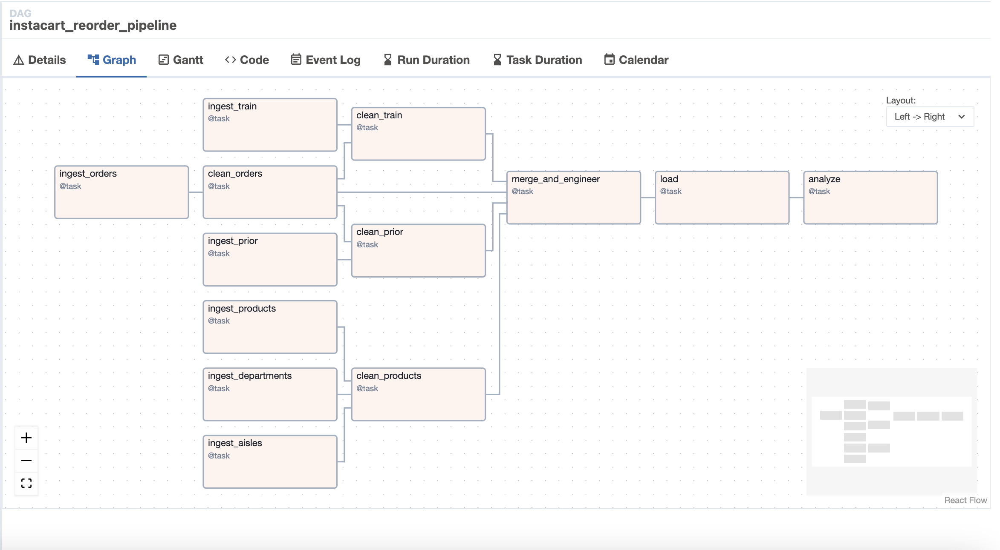
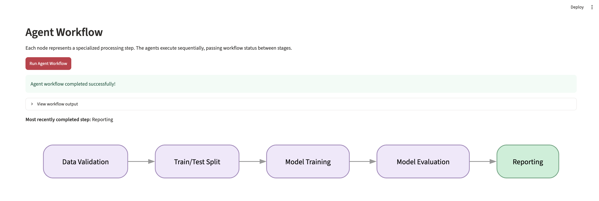
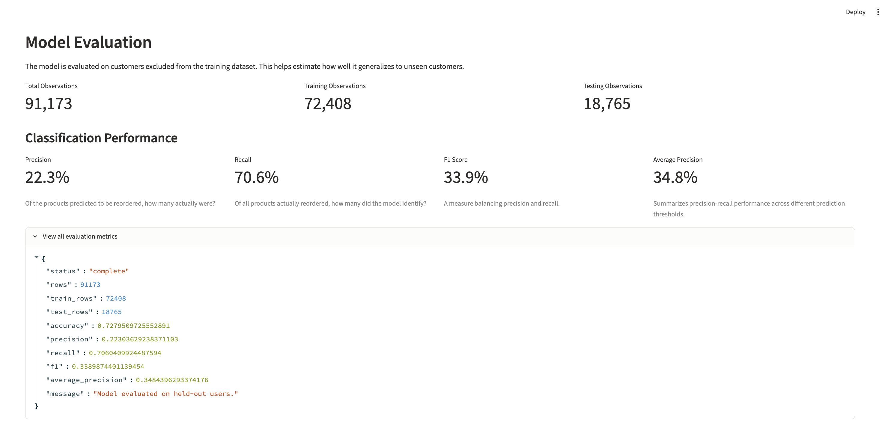

# Instacart Reorder Prediction Pipeline

An end-to-end data engineering and machine learning project using **Apache Airflow, PostgreSQL, Docker, and LangGraph** to predict whether customers will reorder previously purchased products.

## 1. Project Overview

This project consists of two workflows:

- **Airflow Data Pipeline:** Ingests, cleans, merges, and processes Instacart grocery order data.
- **Agent-Based ML Workflow:** Uses specialized agents to prepare data, train a logistic regression model, evaluate predictions, and report results.

## 2. Data Pipeline

**Dataset:** Instacart Market Basket Analysis, containing customer orders, products, aisles, departments, and order-product relationships.

The Airflow pipeline performs the following steps:

1. **Ingest:** Load six related datasets into the pipeline.
2. **Clean:** Validate and transform order and product data.
3. **Merge:** Combine datasets and engineer features describing customers' purchase histories.
4. **Load:** Store the processed data in PostgreSQL.
5. **Analyze:** Use the processed data for reorder prediction.

The DAG runs on a **weekly schedule (`@weekly`)**. Independent ingestion and cleaning tasks run in parallel where possible, while dependent tasks execute sequentially.

## 3. Agent-Based Machine Learning

The ML workflow uses LangGraph to coordinate five specialized agents.

| Agent            | Responsibility                                              |
| ---------------- | ----------------------------------------------------------- |
| Data Agent       | Reads and validates processed data from PostgreSQL          |
| Split Agent      | Creates training and testing sets with no overlapping users |
| Training Agent   | Trains a logistic regression classifier                     |
| Evaluation Agent | Calculates model performance metrics                        |
| Reporting Agent  | Saves evaluation results                                    |

The workflow is visualized through a Streamlit dashboard, which allows users to execute the agents and view model performance.

## 4. Model Results

The model predicts whether a customer will reorder a previously purchased product using purchase history, product information, and ordering patterns.

**Evaluation on held-out users:**

| Metric            | Result |
| ----------------- | ------ |
| Accuracy          | 72.8%  |
| Precision         | 22.3%  |
| Recall            | 70.6%  |
| F1 Score          | 0.339  |
| Average Precision | 0.348  |

**Key finding:** The model identifies approximately 71% of actual reorders but has relatively low precision, indicating a tradeoff between capturing reorders and generating false positives.

## 5. Running the Project

**Requirements:** Docker and Docker Compose.

### Start the services

From the project root:

```bash
docker compose up -d --build
```

This starts PostgreSQL, Airflow, and the agent service.

### Access Airflow

Open:

http://localhost:8080

Find the `instacart_reorder_pipeline` DAG and trigger it to process the data.

### Run the agent workflow

After the Airflow pipeline completes:

```bash
docker compose exec agents python -m agents.workflow
```

### View the agent dashboard

Open:

http://localhost:8502

Click **Run agent workflow** to execute the ML workflow and view the results.

## 6. Technologies

- **Apache Airflow:** Pipeline scheduling and orchestration
- **PostgreSQL:** Data storage
- **Docker:** Containerized development environment
- **Python / Pandas:** Data processing and feature engineering
- **Scikit-learn:** Logistic regression and model evaluation
- **LangGraph:** Agent workflow coordination
- **Streamlit:** Interactive workflow visualization

## 7. Project Findings

This project demonstrates how scheduled data pipelines can support downstream machine learning workflows. Airflow manages data ingestion and transformation, while LangGraph coordinates the model training and evaluation stages.

The model achieves relatively high recall but low precision, suggesting that additional feature engineering, model tuning, or threshold adjustments could improve reorder predictions.

## Screenshots

### 1. Successful Airflow DAG Execution



### 2. Airflow DAG Graph



### 3. Agent Workflow Graph



### 4. Model Evaluation Results


